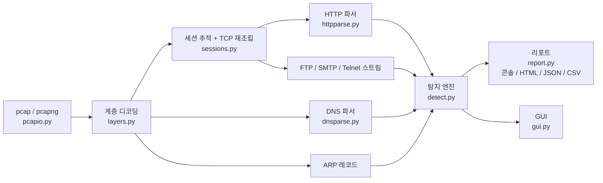

<p align="center"></p>

# pcap for

**내 PC에서 어떤 프로그램이 수상하게 인터넷을 쓰는지 찾아내고, 막고, 보고서까지 써주는 도구**

> 팀 프로젝트 원본 [solmin111/pcap-for](https://github.com/solmin111/pcap-for)(pcap 파일 분석기)를 바탕으로
> 실시간 호스트 감시·차단·사고 보고서 기능을 더한 확장판입니다.

## 한 줄로 말하면

보통 네트워크 분석 도구는 **"이상한 트래픽이 있다"** 까지만 알려줍니다.
pcap for 는 거기서 더 나아가

> **"어떤 프로그램이** 평소와 다르게 행동했고 → **왜** 위험하다고 봤는지 → **막았고** →
> **무엇이 얼마나 나갔는지** (그리고 **모르는 건 모른다고**)"

까지 알려줍니다.

## 이렇게 동작해요 (실제 시연 흐름)

1. **학습** — 평소처럼 PC 를 30분 쓰는 동안, 프로그램마다 "평소에 어디로, 얼마나 자주" 통신하는지 기억합니다.
2. **감시** — 수상한 프로그램이 Temp 폴더에서 실행돼 30초마다 외부 서버에 몰래 접속합니다.
3. **탐지** — 3분 만에 "위험도 높음(8점)" 판정. 점수마다 근거가 붙습니다.
   *(Temp 에서 실행 +2, 처음 보는 프로그램 +2, 처음 보는 서버 +1, 30초 간격 반복 +2, 매번 같은 크기 +1)*
4. **차단** — 사용자가 승인하면 Windows 방화벽으로 그 서버를 막습니다. 30분 뒤 자동 해제, 언제든 되돌리기 가능.
5. **보고서** — 사고 보고서(HTML → PDF)에 무엇이 얼마나 나갔는지, 판단 근거가 된 원본 패킷 번호까지 남깁니다.

## 기존 도구와 뭐가 달라요?

| 알고 싶은 것 | 패킷 분석 도구<br>(Wireshark 등) | 프로그램별 방화벽·모니터 | **pcap for** |
|---|:---:|:---:|:---:|
| 어떤 **프로그램**이 보냈나? | ✗ | ✓ | ✓ |
| 그 프로그램의 **평소와 다른가?** | ✗ | 새 연결 알림 정도 | ✓ 프로그램별로 학습 |
| **왜** 위험하다고 봤나? (근거·점수) | 사람이 직접 분석 | ✗ | ✓ 신호별 점수와 실제 측정값 |
| 막을 수 있나? | ✗ | ✓ | ✓ 승인 후 차단, 자동 해제 |
| **무엇이 얼마나 나갔나?** | 사람이 직접 계산 | ✗ | ✓ 확인됨 / 추정됨 / 확인 불가로 구분 |
| 판단 근거 → **원본 패킷**까지 추적 | — | ✗ | ✓ 증거 ID + Wireshark 필터 |
| 설치·서버 필요 | 설치 | 설치 | 파이썬만 있으면 됨 (외부 라이브러리 없음) |

*비교는 일반적인 기능 기준이며, 제품·버전에 따라 다를 수 있습니다.
각 기능 자체는 상용 보안 제품(EDR)에도 있지만, 이를 **가볍고 근거가 투명한 하나의 흐름**으로 엮은 것이 이 프로젝트의 차별점입니다.*

## 원본에서 무엇이 바뀌었나요?

| | 원본 (pcap-for) | 확장판 (pcap-for-host) |
|---|---|---|
| pcap 파일 분석, 대시보드 | ✓ | ✓ (그대로) |
| 실시간 감시 | 트래픽만 봄 | **어떤 프로그램인지까지** 봄 |
| 판단 기준 | 고정 규칙 (예: SYN 15개 이상) | 고정 규칙 + **프로그램별 평소 모습과 비교** |
| 결과 | 탐지 알림 | 알림 + **위험도 점수 + 차단 + 사고 보고서** |
| 근거 | 증거 문장 | 증거 문장 + **증거 ID → 원본 패킷 번호** |

바뀐 코드는 [확장 커밋 6d9372e](https://github.com/cosmic2003/pcap-for-host/commit/6d9372e)에서 원본과 줄 단위로 비교할 수 있습니다.

## 기능 한눈에 보기

| 기능 | 쉽게 말하면 | 파일 |
|---|---|---|
| 프로세스 귀속 | 인터넷 연결마다 "이건 크롬이 연 것" 처럼 주인 프로그램을 찾아 붙임 | `procmap.py` |
| 실행 파일 검사 | 그 프로그램 파일의 지문(SHA-256), 서명, 실행 위치(Temp 등), 가짜 이름(svch0st) 확인 | `hostid.py` |
| 평소 모습 학습 | 프로그램마다 평소 접속하는 곳·주기·전송량을 기억 | `profiles.py` |
| 이상 탐지·점수 | 처음 보는 프로그램, 일정한 간격의 반복 접속, 주기 급변, 전송량 급증 등을 점수로 합산 → 낮음/중간/높음 | `hostmon.py`, `behavior.py` |
| 타임라인 | 프로그램별로 "언제 무엇이 일어났는지" 순서대로 정리 | `timeline.py` |
| 차단 | 승인하면 방화벽 규칙 추가. 내부망·DNS 는 절대 안 막고, 30분 뒤 자동 해제 | `block.py` |
| 사고 보고서 | 8개 항목 보고서. **확인된 것 / 추정한 것 / 알 수 없는 것**을 나눠서 씀 | `ledger.py`, `incident_report.py` |
| 증거 추적 | 위험도 → 신호 → 증거 ID → 원본 패킷 번호 → Wireshark 필터 | `evidence.py` |
| 시연용 가짜 비콘 | 감염된 척 주기적으로 접속하는 **무해한** 스크립트 (더미 데이터만 보냄) | `demo/fake_beacon.py` |

## 실제로 돌려본 결과 (Windows PC)

| 항목 | 결과 |
|---|---|
| 프로세스 귀속 성공률 | **99.9%** (외부 세션 1,019개 중 미귀속 1개, DNS 질의 제외) |
| 30분 정상 사용 중 오탐 | 규칙 탐지 **0건**, 차단 제안 **0건** (낮음·중간 알림은 일부 있음) |
| 가짜 비콘 탐지 | 실행 **3분** 만에 위험도 높음 → 승인 차단 |
| 증거 추적 | 보고서의 패킷 번호로 Wireshark 에서 해당 세션 패킷만 정확히 걸러짐 |

## 못 하는 것 (솔직하게)

- **침투 자체는 막지 못합니다.** 감염된 뒤 밖으로 통신하는 단계를 잡아 끊는 **보조 방어선**입니다. 백신을 대체하지 않습니다.
- **암호화된 통신(HTTPS 등)의 내용은 보지 못합니다.** 언제, 어디로, 얼마나 보냈는지(행동)로만 판단합니다.
- **"감염 확정"이 아니라 "근거가 붙은 의심"** 입니다. 오탐이 있을 수 있어 차단은 기본적으로 사람이 승인합니다.
- 학습 기간에 이미 감염돼 있었다면 그 통신은 '평소'로 학습됩니다.
- 실시간 감시는 **Windows + 관리자 권한**이 필요합니다. (pcap 파일 분석은 어디서나 가능)

---

아래부터는 자세한 기술 설명입니다.

## 특징

- **실행 환경**: Python 3.10+
- **파일 포맷**: pcap(리틀/빅엔디언, 마이크로초/나노초 타임스탬프), pcapng(SHB/IDB/EPB, if_tsresol 옵션), 잘린 파일 허용
- **링크 계층**: Ethernet(+VLAN/QinQ), Raw IP, Linux cooked capture(SLL)
- **프로토콜 디코딩**: ARP, IPv4, IPv6(확장 헤더 체인), TCP, UDP, ICMP, DNS(압축 포인터+루프 방지), HTTP/1.x(chunked, gzip/deflate, 파이프라이닝), FTP, SMTP, Telnet
- **TCP 스트림 재조립**: 순서 뒤바뀜, 재전송, 겹침 세그먼트 처리
- **증거 무결성**: 입력 파일 SHA-256 기록, 모든 시각 UTC

## 빠른 시작

```bash
git clone https://github.com/cosmic2003/pcap-for-host.git
cd pcap-for-host

# 캡처 파일 분석
python -m pcapfor capture.pcap -v

# GUI 대시보드 (단일 HTML 생성 후 브라우저 자동 오픈)
python -m pcapfor capture.pcap --gui

# IOC 매칭 + 리포트 저장
python -m pcapfor capture.pcap --ioc iocs.txt \
    --html report.html --json report.json --csv sessions.csv
```

## GUI 대시보드 (`--gui`)

분석 결과를 다크 SOC 스타일 대시보드로 보여줍니다. 데이터가 JSON으로 내장된
단일 HTML이라 그대로 제출·공유할 수 있습니다.

- **Overview**: 요약 카드 · 트래픽 타임라인 · 프로토콜 분포 · Top talkers · 우측 탐지 피드(클릭 시 증거/MITRE/대응 펼침)
- **Timeline**: 탐지기 레인별 공격 연대기. 각 탐지의 최초 관찰 시각을 점으로 표시, 점 클릭 시 상세
- **Topology**: 호스트 노드 그래프. 내부/외부/탐지 연루 색 구분, 엣지 굵기=전송량, 노드 클릭 시 호스트 상세
- **Evidence**: 탐지 연루 세션의 재조립 TCP 스트림 뷰어. 평문 자격증명·공격 문자열 자동 하이라이트
- **Board**: 심각도별 칸반 보드. 트리아지(우선순위 분류)용, 카드 클릭 시 증거 펼침
- **Sessions / Detections**: 정렬 가능한 세션 테이블(탐지 연루 하이라이트), 전체 탐지 상세

실시간 모드와도 결합됩니다. `--live --gui` 는 localhost 임시 포트에 같은 대시보드를
띄우고 2초 주기로 갱신합니다(pkt/s, 경과 시간, 실시간 탐지 피드). 서버는 127.0.0.1
전용이며 캡처 종료와 함께 내려갑니다.

### CLI 옵션

| 옵션 | 설명 |
|---|---|
| `--ioc FILE` | 침해지표 목록 매칭 (IP / CIDR / 도메인, 줄 단위, `#` 주석) |
| `--html FILE` | HTML 리포트 저장 |
| `--json FILE` | JSON 결과 저장 |
| `--csv FILE` | 세션 목록 CSV 저장 (엑셀 호환 utf-8-sig) |
| `--gui` | GUI 대시보드 생성 |
| `-v` | 증거·MITRE·대응 권고까지 콘솔 출력 |

**종료 코드**: `0` 이상 없음 · `1` 오류 · `2` high/critical 탐지 존재

## 실시간 탐지 (`--live`)

```bash
python -m pcapfor --live                       # 실시간 감시 시작
python -m pcapfor --live --save evidence.pcap  # 캡처 증거 저장
python -m pcapfor --live --ioc iocs.txt --sweep 5 --duration 300
python -m pcapfor --live --gui                  # 라이브 GUI 대시보드 (localhost)
```

**관리자 권한 세션이 필요합니다.** 터미널을 "관리자 권한으로 실행"으로 연 뒤 실행하세요.
미승격 세션에서 실행하면 안내 메시지와 함께 즉시 종료합니다(종료 코드 1).

| 항목 | 내용 |
|---|---|
| 수집 방법 | Windows raw socket(`SIO_RCVALL`)으로 기본 인터페이스의 IPv4 패킷 수신 |
| 탐지 범위 | 파일 분석과 동일한 파이프라인·탐지기 사용 (이더넷 계층이 없어 ARP 스푸핑만 제외) |
| 증거 보존 | `--save` 로 수신 패킷을 pcap 에 실시간 기록, 나중에 파일 모드로 재분석 가능 |

탐지 스윕은 `--sweep` 초(기본 10)마다 돌고, 같은 탐지는 한 번만 알립니다.
`--duration 0`(기본)이면 Ctrl+C 로 멈출 때까지 감시하며, 종료 시 누적 탐지 수에 따라
종료 코드를 돌려줍니다. 루프백(127.0.0.1) 트래픽은 보이지 않습니다.

## 호스트 감시: 프로세스 귀속 · 프로파일 · 타임라인 (`--live`, Windows)

라이브 모드에서 연결마다 **어떤 프로그램이 만들었는지**를 붙이고, 프로세스별 "평소 모습"과
비교해 위험도를 매깁니다. 결과는 "감염 판정"이 아니라 **근거가 붙은 의심 점수**입니다.

```bash
python -m pcapfor --live --learn --duration 3600   # 1) 깨끗한 상태에서 평소 통신 학습 (경고 없음)
python -m pcapfor --live                           # 2) 감시: 평소 대비 이상 신호를 점수로 표시
```

| 구성 | 내용 |
|---|---|
| 프로세스 귀속 (`procmap.py`) | iphlpapi 연결 테이블을 0.5초마다 조회. 끝난 연결도 120초 캐시, PID 재사용은 (PID, 시작 시각)으로 구분, 실패 시 `<미귀속>` 기록 |
| 실행 파일 신원 (`hostid.py`) | SHA-256, 코드 서명·서명자(PowerShell, 해시별 캐시), Temp/Downloads 실행, 시스템 프로세스 사칭·유사 이름 |
| 프로세스 프로파일 (`profiles.py`) | 프로세스별 목적지·포트·평소 주기·업로드 속도·파일 변경 이력·이상 기록을 JSON 저장. 감시 중 본 것은 '평소'로 자동 편입하지 않음 |
| 패턴 비교 (`hostmon.py`, `behavior.py`) | 새 프로세스/목적지, 비표준 포트, 비커닝, 크기 규칙성, 주기 급변(예: 10분→30초), 장시간 연결, 업로드 급증 |
| 타임라인 (`timeline.py`) | 프로세스별 이벤트와 누적 위험도, 사건(incident) 묶기, '높음' 도달 시 차단 제안 (자동 차단 아님) |

- **확신도 4단계**: 확인됨 / 일부 확인됨(DNS 기반 이름) / 추정됨(ECH, 학습 기준 비교) / 확인 불가(QUIC 등 이름 없음)
- 브라우저의 새 사이트 접속, 평소 도메인의 새 하위 서버(`cdn.kakao.com`)는 이상으로 보지 않음
- 서명이 없다는 사실만으로는 악성으로 판단하지 않음 (1점짜리 약한 신호)
- 실행 파일이 바뀌어도 **서명자가 같으면 정상 업데이트로 추정**, 서명이 사라지거나 서명자가 바뀌면 강한 신호
- 종료 시 `pcapfor_profiles.json`(프로파일), `pcapfor_events.json`(이벤트·사건) 저장

**전제와 한계**: 학습 구간의 PC 가 깨끗하다고 가정합니다. Windows raw socket 은 수신 패킷을 TCP 스택 처리 뒤에 넘겨주므로, 증거 pcap 을 Wireshark 로 열면 'Spurious Retransmission' 같은 순서 경고가 보일 수 있습니다(데이터 유실 아님). 아주 짧은 연결은 조회 전에 끝나
`<미귀속>`이 될 수 있고(종료 시 귀속 성공률 표시), 암호화 통신은 내용이 아닌 시각·양·목적지로만 판단합니다.

테스트(윈도우 없이 가짜 연결 테이블로 학습→감시 시나리오 재현): `python tests/test_hostmon.py`

### 차단 · 피해 장부 · 사고 보고서

```bash
python -m pcapfor --live --block ask              # 위험도 '높음'이면 차단 제안 → 콘솔에 approve N 입력
python -m pcapfor --live --block ask --dry-run    # 명령은 실행하지 않고 기록만 (시연 리허설용)
python -m pcapfor --unblock-all                   # 이 도구가 만든 방화벽 규칙 전부 삭제
python -m pcapfor --report-from pcapfor_events.json --report 보고서.html   # 보고서만 다시 생성
```

| 구성 | 내용 |
|---|---|
| 차단 (`block.py`) | `netsh advfirewall` 로 목적지 IP 의 in/out 차단 규칙(`pcapfor-block-N`) 생성. 모드 off / suggest(기본, 명령만 제시) / ask(콘솔 승인) / auto(실험) |
| 안전장치 | 사설망·이 PC·관측된 DNS 서버·`--allow` 목록은 절대 차단 안 함, TTL 30분 자동 해제, 종료 시 해제(`--keep-blocks` 로 유지), 상태 파일로 비정상 종료 후 복구, 적용 실패 시 반쯤 생긴 규칙 정리 |
| 콘솔 명령 | `approve N` / `deny N` / `unblock N` / `kill N`(PID 재사용이면 거부) / `list` / `rollback` |
| 피해 장부 (`ledger.py`) | 사건별 목적지·전송량·내용 종류(평문/TLS/QUIC/고엔트로피 추정), 차단 전 전송량, 차단 이후 연결 시도·성립·전송 |
| 사고 보고서 (`incident_report.py`) | 최초 이상 시각, 프로세스 정보, 목적지, 탐지 근거(+MITRE), 전송 기록, 차단 여부·시각, 차단 이후 변화, 확인됨/추정됨/확인 불가 — 위험도 그래프 포함 단일 HTML, Ctrl+P 로 PDF |

막는 단위는 프로그램이 아니라 **목적지 IP** 입니다(감염 파일이 이름·위치를 바꿔도 유지되도록).
첫 패킷 몇 개는 탐지 전에 이미 나가므로, 이 기능은 침투 방어가 아니라 **감염 이후 피해 확대를 끊는** 용도입니다.

테스트: `python tests/test_block_report.py` (시뮬레이션 사고 보고서 HTML 생성)

## 시연 방법 (실제 PC, Windows)

가짜 비콘(`demo/fake_beacon.py`)은 **감염된 프로그램의 네트워크 행동만 흉내 내는 무해한 스크립트**입니다.
파일·개인정보를 읽지 않고 무작위 더미 바이트만 보내며, 정해진 시간 뒤 스스로 종료합니다.
파이썬 실행 파일을 `%TEMP%\pcapfor_demo\update.exe` 로 복사해 실행하므로, 도구 입장에선
"Temp 에서 실행된, 학습 때 없던 프로그램"이 됩니다.

```powershell
# 0) (사전) 평소처럼 PC 를 쓰며 30분 이상 학습
python -m pcapfor --live --learn --duration 1800

# 1) 관리자 창 A: 감시 + 콘솔 승인 차단
python -m pcapfor --live --block ask

# 2) 일반 창 B: 가짜 비콘 시작 (30초 주기, 8번째 체크인 뒤 1MB 더미 업로드, 10분 뒤 종료)
python demo\fake_beacon.py install

# 3) 창 A 에 '차단 제안 #1' 이 뜨면 approve 1 → 창 B 로그에 '체크인 실패' 가 찍히는지 확인
# 4) 창 A 에서 Ctrl+C → pcapfor_incidents.html 열어 Ctrl+P → PDF 저장
# 5) 정리
python demo\fake_beacon.py clean
python -m pcapfor --unblock-all
```

변형: `--name svchost.exe`(시스템 프로세스 사칭), `--mode plain`(비표준 포트 4444),
`--jitter 0.3`(주기 ±30% 흔들기 — 탐지가 어디서 깨지는지 보는 평가 실험용).

## 아키텍처



분석 파이프라인(`analyzer.py`)은 패킷을 한 번만 순회하며 세션 테이블과
프로토콜별 중간 산출물(`AnalysisData`)을 만들고, 탐지기들은 그 산출물만 읽습니다.
탐지기를 새로 추가하려면 `detect.py`에 함수 하나를 쓰고 `run_all`에 등록하면 됩니다.

## 탐지 항목

| 분류 | 탐지 | 판단 근거 | MITRE ATT&CK |
|---|---|---|---|
| 정찰 | 포트 스캔 | 한 출발지가 응답 없는 SYN을 서로 다른 포트 15개 이상에 전송 (응답한 열린 포트도 함께 표시) | T1046 |
| 정찰 | 호스트 스윕 | 같은 포트로 호스트 10대 이상 접촉 | T1018 |
| 계정 공격 | FTP 브루트포스 | 530 응답 8회 이상 | T1110 |
| 계정 공격 | HTTP 인증 브루트포스 | 동일 경로 401/403 8회 이상 | T1110.001 |
| 계정 공격 | SSH/Telnet/RDP 반복 접속 | 짧은 연결 반복 (암호화 구간은 패턴으로 판단) | T1110 |
| 자격증명 | FTP 평문 로그인 | USER/PASS + 230 성공 응답 | T1040 |
| 자격증명 | HTTP Basic / 폼 비밀번호 | Authorization 헤더, POST 본문 사용자명·password 필드 | T1040 |
| 자격증명 | SMTP 평문 인증 | AUTH LOGIN/PLAIN base64 디코딩, 메일 유출 징후 | T1048.003, T1040 |
| 자격증명 | Telnet 평문 로그인 | 옵션 협상 제거 후 계정·로그인 결과·실행 명령 복원 | T1040, T1021 |
| 웹 공격 | SQLi · XSS · LFI · Log4Shell · Shellshock · 명령주입 | URI/본문/헤더 시그니처 (URL 디코딩 후 검사) | T1190, T1189 |
| C2/유출 | DNS 터널링 | 서브도메인 길이·엔트로피·고유율, 다층 존 집계, NULL 레코드 | T1071.004, T1048 |
| C2/유출 | DGA | 한 호스트의 고엔트로피 NXDOMAIN 다발 | T1568.002 |
| C2/유출 | 비커닝 | 연결 간격 변동계수(CV) ≤ 0.15 의 기계적 주기성 | T1071, T1573 |
| C2/유출 | HTTP POST C2 | 같은 경로로 16진 암호문 필드를 담은 POST 반복 | T1071.001, T1132 |
| C2/유출 | 원격 제어(RAT) 화면 유출 | 비표준 포트로 이미지 반복 업로드 + 짧은 서버 응답 | T1113, T1041, T1219 |
| 스푸핑 | ARP 스푸핑 | 한 IP를 복수 MAC이 주장, 또는 한 MAC이 복수 IP를 주장 | T1557.002 |
| IOC | IP/CIDR/도메인 일치 | 사용자 제공 침해지표 목록 | - |
